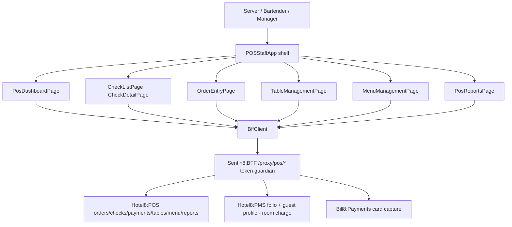

# Hotel8:ePOS

## 1. Summary

Hotel8:ePOS is a Flutter application for restaurant and F&B staff - the
frontend for all Hotel8:POS point-of-sale operations. Servers take orders,
manage checks, process payments, run floor plans, and pull shift reports;
managers 86 menu items and administer outlets. The app is a thin client over
the Hotel8:POS BFF proxy surface (`/proxy/pos/*/v1/*`), with the PMS folio
lookup as the one cross-service touchpoint for room charges.

## 2. Motivation

POS software is the highest-frequency transaction surface in a hotel
restaurant operation: every order, void, discount, and payment passes through
it. ePOS gives hotel8 a native terminal that speaks the same contract layer as
the POS service (no bespoke middleware), enforces role-based operations
through Sentin8:Auth scopes, and posts room charges directly into the PMS
folio - removing the swipe-and-reconcile glue that standalone restaurant POS
systems need when they live inside a hotel.

## 3. Architecture & High-Level Design

One shell owns the sidebar navigation and the single `BffClient`; each of the
seven screen widgets is a `StatefulWidget` receiving `client` and `outletId`
via constructor. Models (`lib/models.dart`) mirror the POS contract shapes -
outlets, menu categories/items/modifiers, checks, order items, payments,
tables, server shifts, and report data.

## 4. Key Traits and Data Structures

* `BffClient` - the typed HTTP boundary; a method per proxy endpoint;
  `BffException` normalizes failures; JSON mapping lives in the model layer.
* `Check` / `OrderItem` / `Payment` - the transactional core: a check holds
  items, payment state and totals; order items carry modifiers and seat
  assignment.
* `MenuItem` / `MenuCategory` / `Modifier` - the menu tree the order entry
  screen browses, with 86-availability toggles.
* `Table` - floor-plan state (`table_status` lifecycle) driving the color
  codes in table management.
* `ServerShift` / `ReportData` - the reporting projections (dashboard, shifts,
  typed reports).

## 5. Rationale, Trade-offs, and Alternatives

* **Web/build-target app today, kiosk mode later.** The current build is the
  staff terminal (web + tablet form factors). Rejected: embedding kiosk
  self-service flows here - they belong to Hotel8:eKiosk with different
  hardware and security posture.
* **BFF-only egress** - same pattern as the other hotel8 apps: no direct
  service URLs, keeping token custody, tenant resolution and rate limiting
  uniform. Rejected: a local POS cache with eventual write-back (offline
  queue) until the platform's offline story is finalized - a broken queue on a
  payment screen is worse than a visible error.
* **Constructor-injected client and outlet id** rather than a global service
  locator - makes every screen testable and keeps the outlet context explicit;
  the outlet id is the one seam that runtime context will fill.
* **Plain `setState` screens over a state-management framework** - terminal
  flows are linear and local; `provider` is declared for cross-screen state
  (e.g. an open check drawer) but nothing forces it yet.

## 6. Internal Implementation & Invariants (Private Design)

* **Invariants:**
  * Every proxy path is rooted in `/proxy/pos/` (menu, checks, orders,
    payments, tables, reports segments); the single exception is the PMS
    folio/profile path used by the room-charge flow and the Bill8 payments
    proxy for card capture.
  * Non-2xx ⇒ `BffException`; screens never branch on raw status codes.
  * A check's financial fields are server-computed - the client renders
    totals but does not recompute them for decisions.
  * The `outletId` is set once by the shell and passed down; screens cannot
    switch outlets mid-flow.
* Void/void-with-reason and payment endpoints are deliberately distinct
  calls so manager-approval gating can happen server-side per action.
* The client is closed in the shell's `dispose`.

## 7. Unresolved Questions / Future Designs

* Outlet selection is currently a fixed demo id; runtime context
  (`GET /v1/app/runtime/context`) and staff sign-in gating are the two
  bootstrap gaps before multi-outlet operation.
* Offline order-taking and payment queueing (card pre-auth deferred
  settlement) are deferred until the platform offline pattern is chosen.
* Kitchen-display/printer-group routing and hardware (drawer, printer,
  terminal) integrations ride on platform channels that are not yet stood
  up in the web build.

---

**Architecture & Design:** hotel8:epos and its underlying concepts were designed by [Hamid Jahanzad](https://www.linkedin.com/in/hamidjahanzad/).
